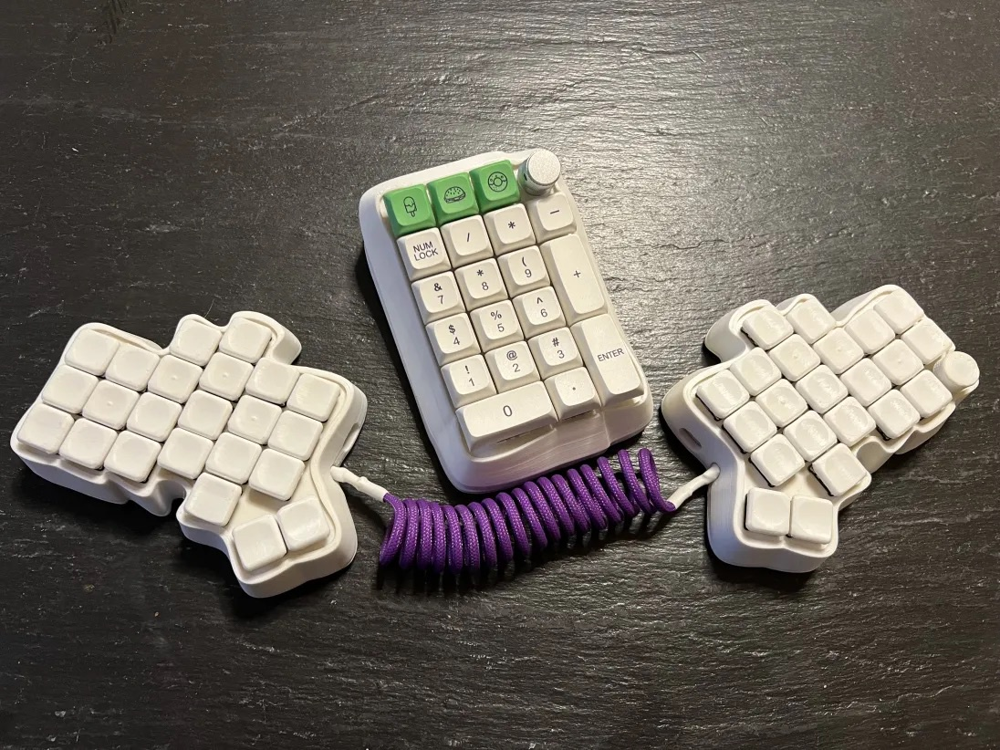

  

## 🎹 Custom Keyboards in This Fork

**This is the default branch containing [custom handwired keyboard designs by IIxauII](https://imgur.com/gallery/3d-printed-handwired-keyboards-5OE84jd):**

- **[Cosmos XAU](/keyboards/handwired/cosmos_xau/)** - Full-size custom keyboard
- **[Cosmos XAU Mini](/keyboards/handwired/cosmos_xau_mini/)** - Compact variant
- **[Cosmos XAU Numpad](/keyboards/handwired/cosmos_xau_numpad/)** - Standalone numpad

All keyboards support VIA configurator. See individual keyboard folders for build guides and details.
